# agent-mesh

Let Claude Code sessions on different machines work together.

You run many Claude Code sessions on each machine, say a Linux box and a Mac. Normally they can only talk to sessions on the same machine. With agent-mesh you pick one **lead** session per machine. The leads talk to each other across machines, hand work to the right machine, and report back. Every other session keeps working as usual.

<p align="center"></p>

## What you need

- Two or more machines (Linux or macOS) with [Claude Code](https://claude.com/claude-code) logged in
- [Tailscale](https://tailscale.com/download) on each machine, signed in to the same account

## Set up (about 2 minutes)

<p align="center"></p>

**1. Install** on every machine. Run this in a terminal:

```sh
curl -fsSL https://raw.githubusercontent.com/felixn678/agent-mesh/main/scripts/install.sh | sh
```

**2. On one always-on machine (the hub):**

```sh
agent-mesh up
agent-mesh invite mac        # any name for the other machine; prints a secret code
```

**3. On every other machine:**

```sh
agent-mesh join              # paste the code when asked
```

**4. Restart** the Claude Code sessions that are open.

Something wrong? `agent-mesh doctor` checks the machine and tells you how to fix each problem.

## Use it

In the Claude Code session that should be the lead on each machine, type:

```
/am:on
```

Then just ask in plain words, for example:

> Build the login API here, and ask the Mac to build the iOS screen and test it on the simulator.

The lead sends the Mac part to the Mac lead, which shares it with the sessions on the Mac and sends back one summary. `/am:off` turns a session back into an ordinary one.

**Tip:** tell agent-mesh what each machine is good at, so leads pick the right machine by themselves:

```sh
agent-mesh host-note "backend, API, database, web"            # run on the Linux box
agent-mesh host-note "iOS and React Native, Xcode, simulator" # run on the Mac
```

## Update

```sh
agent-mesh update            # on each machine, hub machine first
```

## Learn more

- [Usage guide](docs/usage-guide.md): every command, how tasks travel, the optional overnight daemon, where files live
- [Troubleshooting](docs/troubleshooting.md) and limits
- [Security](docs/security.md): tokens and what a session in the mesh may do
- [Manual setup and daemon config](docs/deployment-guide.md)
- [System architecture](docs/system-architecture.md) and [code map](docs/codebase-summary.md)
